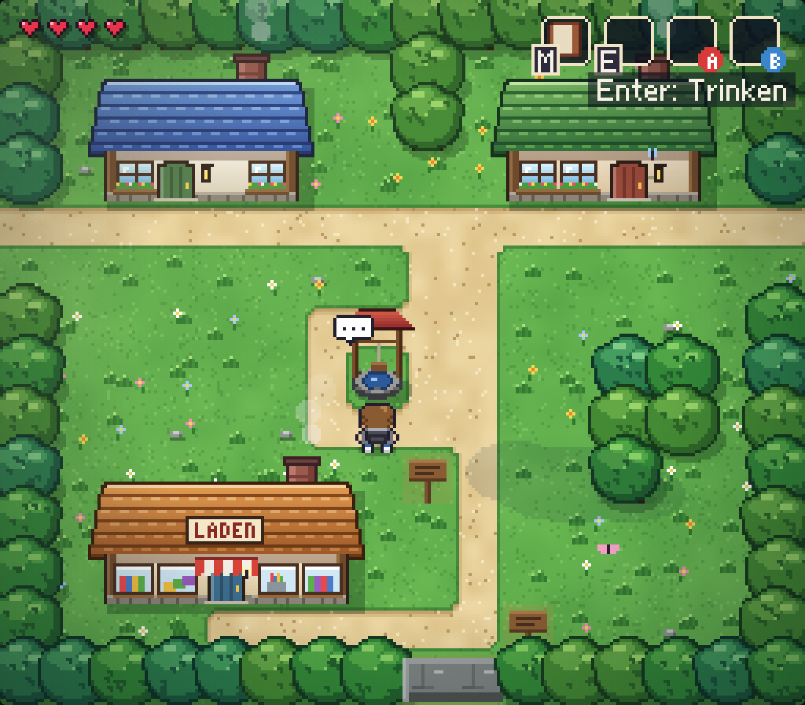

# Die Legende der Parabel

Ein Mathe-Übungsspiel im Stil eines 2D-Zelda, für die 9. Klasse der Realschule Bayern (Quadratische Funktionen und quadratische Gleichungen). Die Lehrkraft führt die Themen ein, das Spiel dient zum Üben und Vertiefen.

| Titelbild | Dorfplatz | Höhle der Parabeln |
|---|---|---|
|  |  |  |

## Starten

- Online: GitHub Pages (Link siehe Repository-Beschreibung).
- Lokal: `index.html` im Browser öffnen. Kein Server, kein Build-Schritt nötig.

## Steuerung

| Aktion | PC | iPad |
|---|---|---|
| Bewegen | Pfeiltasten / WASD | Steuerkreuz links unten |
| A: Reden, Weiter, Bestätigen | Enter / Leertaste | rote Taste |
| B: Abbrechen, Schließen | Esc / Rücktaste | blaue Taste |
| Merkbuch | M | Buch-Taste |
| Schwert | E | Schwert-Taste |

## Aufbau

- `index.html` lädt alle Skripte aus `js/` und das Stylesheet `css/style.css`.
- `js/main.js`: Spielschleife und Abläufe.
- `js/tasks.js`: Aufgabenvorlagen. `js/taskui.js`: Aufgabenbox.
- `js/dungeon.js`, `js/turm.js`, `js/wasser.js`, `js/sandtempel.js`, `js/schule.js`: die Dungeons.
- `js/save.js`: Spielstand im Local Storage.
- `js/testpage.js`: Testseite für die Lehrkraft (Schild auf dem Dorfplatz), zeigt Beispielaufgaben mit Lösung.
- `AGENTS.md`: Projektregeln und Entscheidungen.

## Speichern

Der Spielstand wird automatisch an Rastquellen und nach Dungeons im Browser (Local Storage) gespeichert. Er bleibt nur auf dem jeweiligen Gerät. Es werden keine Daten übertragen.
