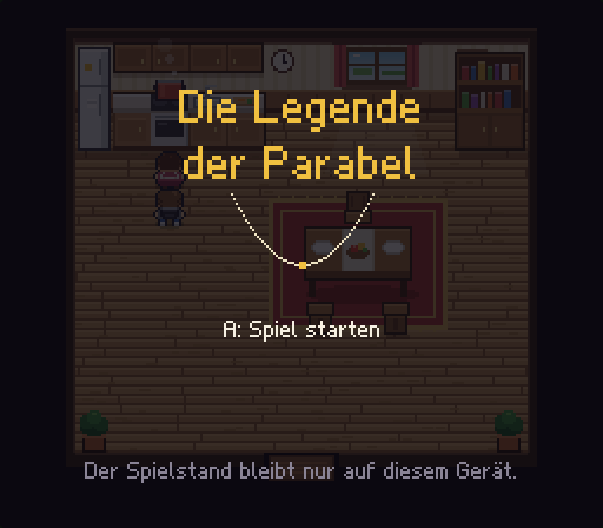
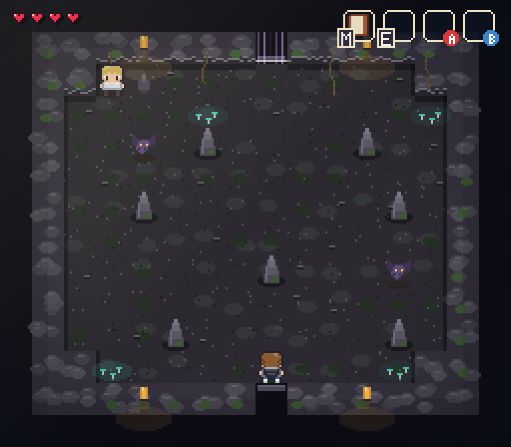

# Die Legende der Parabel

Ein Mathe-Übungsspiel als Top-Down-Abenteuer im Stil eines 2D-Zelda. Es ist für die 9. Klasse der Realschule Bayern gedacht (WPF I, LehrplanPLUS M9, Lernbereich 7: Quadratische Funktionen und quadratische Gleichungen). Das Spiel dient zum Üben und Vertiefen: Die Lehrkraft führt jedes Thema im Unterricht ein, die Figuren im Spiel liefern nur kurze Merksätze.

| Titelbild | Dorfplatz | Höhle der Parabeln |
|---|---|---|
|  |  |  |

## Die Geschichte

Die Schule im Dorf ist zerstört, die Lehrerinnen und Lehrer werden darin gefangen gehalten. Dahinter steckt Graf Gerade, der nichts duldet, was sich krümmt. Er hat das Schultor mit vier Siegeln verschlossen. Jeder der vier Wächter draußen im Land trägt eines davon. Die Schülerinnen und Schüler befreien die Wächter, indem sie Aufgaben lösen. Nach dem vierten Siegel öffnet sich das Schultor zum Finale.

## Inhalte: fünf Dungeons

| Nr. | Dungeon | Thema |
|---|---|---|
| 1 | Höhle der Parabeln | Normalparabel, Streckfaktor a, Scheitel |
| 2 | Leuchtturm | Scheitelform y = a(x − xs)² + ys, Gleichung aufstellen, Wertemenge |
| 3 | Wasserkraftwerk | allgemeine Form y = ax² + bx + c, Umformen, Parabel durch drei Punkte |
| 4 | Sandtempel | Diskriminante, Anzahl der Lösungen, Lösungsformel, Nullstellen |
| 5 | Zerstörte Schule (Finale) | Schnittpunkte mit Geraden, Wurfparabeln, Extremwerte |

- **Gegner:** Wer ein Monster berührt, bekommt eine Aufgabe. Die Zahlen werden neu erzeugt und haben immer „schöne“ Lösungen.
- **Bosse:** Jeder Wächter stellt feste Aufgaben, die die Lehrkraft geprüft hat.
- **Rätsel:** Vor jedem Boss liegt ein Rätsel, zum Beispiel Fackeln auf Punkte einer Parabel setzen oder Hebel für a, b und c einstellen.
- **Fehler:** Eine falsche Antwort kostet ein Herz. Ab dem 2. Versuch erscheint ein Hinweis, nach dem 3. Fehlversuch die Lösung.
- **Merkbuch:** Alle Merksätze der Figuren landen automatisch im Merkbuch.
- **Schwert:** Das Schwert gibt es aus freiwilligen Rätsel-Truhen. Es überspringt eine Aufgabe und zerbricht danach, bei Bossen wirkt es nicht.

## Starten

- **Online:** über GitHub Pages: <https://sallyismyguitar.github.io/Die-Legende-der-Parabel/>
- **Lokal:** `index.html` im Browser öffnen. Kein Server und kein Build-Schritt nötig.
- **iPad:** In Safari öffnen, dann „Teilen → Zum Home-Bildschirm“. Das Spiel läuft danach im Vollbild und im Querformat.
- **Neu laden auf dem iPad (Home-Bildschirm):** App im App-Umschalter nach oben wegwischen und über das Symbol neu öffnen. Nach einem Update kann es einige Minuten dauern, bis die neue Version erscheint.

## Steuerung

| Aktion | PC | iPad |
|---|---|---|
| Bewegen | Pfeiltasten / WASD | Steuerkreuz links unten |
| A: Reden, Weiter, Bestätigen | Enter / Leertaste | rote Taste |
| B: Abbrechen, Schließen | Esc / Rücktaste | blaue Taste |
| Merkbuch | M | Buch-Taste |
| Schwert | E | Schwert-Taste |

Gespräche werden immer mit A bis zum Ende durchgeklickt, B bricht sie nicht ab.

## Für Lehrkräfte

- **Testseite:** Ein Schild auf dem Dorfplatz öffnet die Testseite. Sie zeigt pro Aufgabentyp zehn Beispielaufgaben mit Lösung und bietet eine Probeaufgabe ohne Folgen.
- **Fehlerstatistik:** Das Spiel zählt richtige und falsche Antworten. Die Zahlen stehen im Merkbuch auf der Seite „Spielstand“ und im Abspann.
- **Spielstand-Code:** Auf der Seite „Spielstand“ im Merkbuch zeigt „Code zeigen“ einen kurzen Text mit Fortschritt und Statistik. Ihn können die Schülerinnen und Schüler vorzeigen oder auf einem anderen Gerät einfügen.
- **Wiederholen:** Nach dem Finale startet die Steintafel am Eingang jedes Dungeons eine Wiederholung mit neuen Zahlen. Die Boss-Aufgaben bleiben fest.

## Speichern und Datenschutz

- Der Spielstand wird automatisch an Rastquellen und nach Fortschritten im Browser gespeichert (Local Storage). Er bleibt nur auf dem jeweiligen Gerät.
- Das Spiel sammelt und sendet keine Daten. Es gibt keinen Server, keine Anmeldung und keine externen Bibliotheken oder Schriften.
- Figuren tragen Rollenbezeichnungen (Mama, Nachbarin, Verkäufer …), keine echten Namen.

## Aufbau

- `index.html` lädt alle Skripte aus `js/` per Script-Tag und das Stylesheet `css/style.css`. Es gibt kein Build-Werkzeug.
- Die gesamte Grafik ist Pixelgrafik und wird per Code auf ein Canvas gezeichnet (256 × 224 Pixel, Kacheln 16 × 16).

| Bereich | Dateien |
|---|---|
| Spielschleife und Abläufe | `main.js`, `config.js`, `input.js`, `player.js`, `dialog.js`, `hud.js` |
| Grafik | `render.js`, `font.js`, `fx.js`, `buildings.js`, `people.js`, `interior.js`, `rooms.js` |
| Oberwelt | `world.js`, `wueste.js`, `dietl.js` |
| Aufgaben | `tasks.js`, `taskui.js`, `testpage.js` |
| Kampf | `enemies.js`, `boss.js`, `sword.js` |
| Dungeons | `dungeon.js`, `turm.js`, `wasser.js`, `sandtempel.js`, `schule.js` |
| Rätsel | `raetsel.js`, `spiegel.js`, `schaltwarte.js`, `platten.js` |
| Merkbuch, Speichern, Abspann | `merkbuch.js`, `save.js`, `codepanel.js`, `abspann.js` |

Projektregeln, Story-Entscheidungen und freigegebene Texte stehen in [`AGENTS.md`](AGENTS.md).
